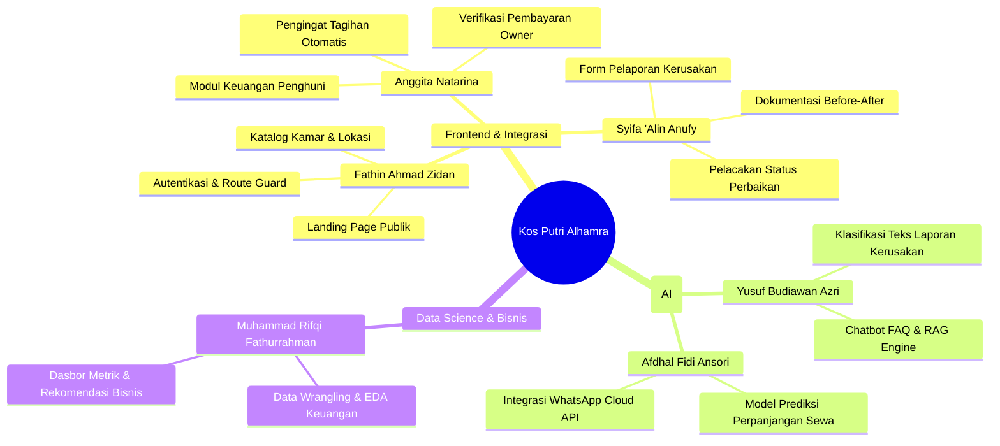
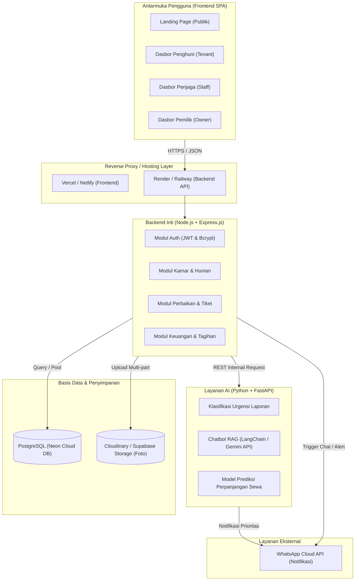
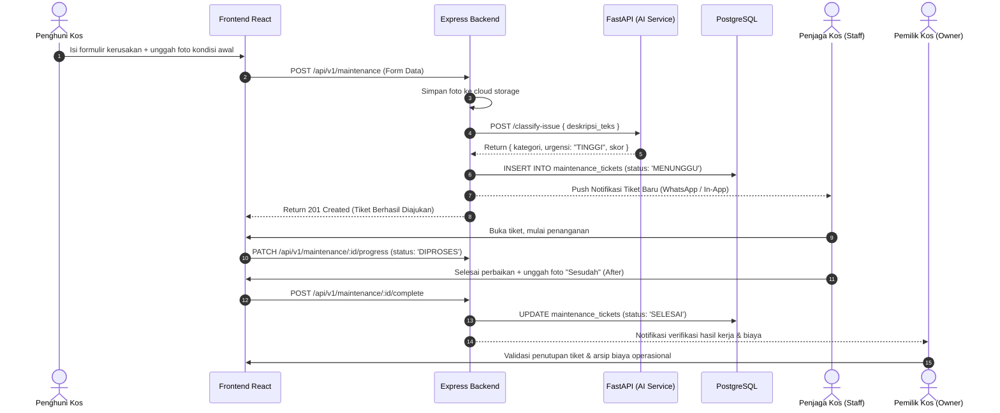
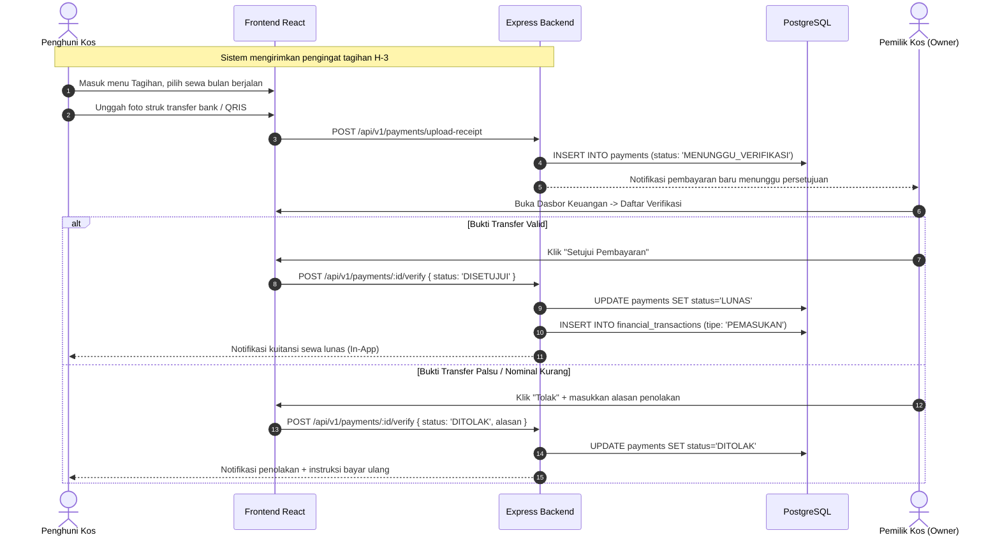
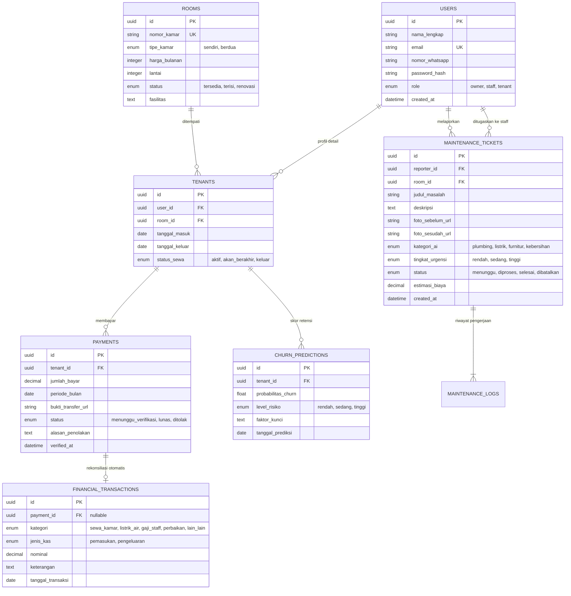

# Spesifikasi Teknis & Produk (spec.md)
## Website Pengelolaan Operasional dan Keuangan Kos Putri Alhamra

> **Identitas Proyek:** Capstone Project ASAH 2026 — Tim **A26-CS136**  
> **Versi Dokumen:** `v2.0.0` | **Status:** Disetujui (*Ready for Development*)  
> **Target Pengguna:** Pemilik Kos (*Owner*), Penjaga Kos (*Staff*), Penghuni Kos (*Tenant*), Calon Penghuni (*Guest/Public*)  
> **Dokumen Pendukung:** [`agent.md`](./agent.md) (Aturan Koding & Alur Kerja) | [`styleguide.md`](./styleguide.md) (Panduan Desain & UI/UX)

---

## Daftar Isi
1. [Ringkasan Eksekutif & Latar Belakang](#1-ringkasan-eksekutif--latar-belakang)
2. [Peran Pengguna & Matriks Hak Akses (RBAC)](#2-peran-pengguna--matriks-hak-akses-rbac)
3. [Daftar Fitur & Pembagian Tanggung Jawab Tim](#3-daftar-fitur--pembagian-tanggung-jawab-tim)
4. [Arsitektur Sistem & Diagram Aliran Data](#4-arsitektur-sistem--diagram-aliran-data)
5. [Alur Bisnis Utama (Core Workflows)](#5-alur-bisnis-utama-core-workflows)
6. [Skema Data & Entitas Utama (Database ERD)](#6-skema-data--entitas-utama-database-erd)
7. [Spesifikasi REST API & Kontrak Data](#7-spesifikasi-rest-api--kontrak-data)
8. [Arsitektur & Konvensi Frontend](#8-arsitektur--konvensi-frontend)
9. [Struktur Direktori Proyek](#9-struktur-direktori-proyek)
10. [Kebutuhan Non-Fungsional & Kriteria Penerimaan](#10-kebutuhan-non-fungsional--kriteria-penerimaan)

---

## 1. Ringkasan Eksekutif & Latar Belakang

### 1.1 Profil Bisnis
**Kos Putri Alhamra** adalah penyedia hunian kos putri berperabot (*fully furnished*) milik Bapak Yusuf yang berlokasi strategis di Pekanbaru, melayani mahasiswi dari Universitas Riau (UNRI), UIN Suska Riau, dan STIFAR Riau. Usaha ini menawarkan dua kategori kamar: **Tipe Sendiri** (privat) dan **Tipe Berdua** (berbagi).

### 1.2 Permasalahan Nyata Operasional (*Problem Statement*)
1. **Pelaporan Kerusakan Tercecer di WhatsApp:** Keluhan fasilitas (keran bocor, lampu padam, AC rusak) menumpuk di chat pribadi, tanpa riwayat penanganan (*tracking*), memicu keterlambatan perbaikan dan komplain berulang.
2. **Dokumentasi Perbaikan Minim:** Tidak ada bukti visual kondisi sebelum (*before*) dan sesudah (*after*) pekerjaan teknis oleh penjaga kos, menyulitkan pemilik memvalidasi pengeluaran jasa tukang.
3. **Pencatatan Keuangan Manual & Terfragmentasi:** Rekap sewa dan pengeluaran operasional dicatat secara manual di buku fisik, Excel, atau catatan HP, berisiko salah hitung dan kehilangan jejak penunggak sewa.
4. **Respon Informasi Calon Penyewa Terbatas:** Calon penghuni sering menanyakan ketersediaan kamar, harga, dan fasilitas di jam kerja ketika pengelola sedang sibuk.

### 1.3 Solusi yang Dibangun (*Value Proposition*)
Platform web terintegrasi berbasis **React + Express.js + PostgreSQL + Layanan AI (FastAPI)** yang menyediakan:
- Pelaporan kerusakan digital terstruktur dengan klasifikasi otomatis berbasis AI.
- Dokumentasi pemantauan perbaikan berbasis foto *before-after*.
- Verifikasi pembayaran sewa digital dan rekonsiliasi arus kas otomatis.
- Dasbor analitik bisnis dan prediksi retensi penghuni (*churn risk*).
- Asisten virtual AI 24/7 (RAG & Intent Router) untuk informasi kos dan panduan layanan.

---

## 2. Peran Pengguna & Matriks Hak Akses (RBAC)

Sistem membedakan hak akses secara ketat melalui JSON Web Token (JWT) dengan peran (*role*) terenkripsi:

| Fitur / Modul | Publik (*Guest*) | Penghuni (*Tenant*) | Penjaga (*Staff*) | Pemilik (*Owner*) |
|---|:---:|:---:|:---:|:---:|
| Lihat Landing Page & Informasi Kamar | ✅ Read | ✅ Read | ✅ Read | ✅ Read |
| Interaksi Chatbot Informasi Umum | ✅ Read | ✅ Read | ✅ Read | ✅ Read |
| Buat Laporan Kerusakan Fasilitas | ❌ | ✅ Create | ✅ Create | ❌ |
| Pantau Status Laporan Kerusakan Pribadi | ❌ | ✅ Read | ❌ | ❌ |
| Perbarui Progres & Foto *Before-After* | ❌ | ❌ | ✅ Update | ❌ |
| Verifikasi Akhir & Tutup Laporan | ❌ | ❌ | ❌ | ✅ Full Control |
| Unggah Bukti Pembayaran Sewa | ❌ | ✅ Create | ❌ | ❌ |
| Verifikasi Pembayaran (Setuju / Tolak) | ❌ | ❌ | ❌ | ✅ Full Control |
| Catat Pengeluaran Operasional Harian | ❌ | ❌ | ✅ Create (Draft) | ✅ Full Control |
| Akses Dasbor Keuangan & Analitik Bisnis | ❌ | ❌ | ❌ | ✅ Read / Export |
| Akses Model Prediksi Perpanjangan Sewa | ❌ | ❌ | ❌ | ✅ Read |
| Manajemen Data Kamar & Penghuni | ❌ | ❌ | ✅ Read | ✅ Full Control |

---

## 3. Daftar Fitur & Pembagian Tanggung Jawab Tim

Tim Pengembang Capstone **A26-CS136**:



### Tabel Rincian Modul & Deliverable

| No | Modul / Fitur | Deskripsi Fungsional | Input / Output | Penanggung Jawab |
|---|---|---|---|---|
| **M1** | **Landing Page & Profil Kos** | Informasi publik tipe kamar, harga, fasilitas, lokasi via peta, galeri foto, aturan kos, FAQ, dan floating WhatsApp. | **Input:** Navigasi pengunjung<br>**Output:** Tampilan responsif & dinamis | Fathin Ahmad Zidan *(AI Full-Stack)* |
| **M2** | **Autentikasi & RBAC Guard** | Login aman berbasis JWT (3 peran), penyimpanan token aman, auto-redirect sesuai peran, dan tombol *Quick Login* untuk pengujian. | **Input:** Email/Username + Password<br>**Output:** Token JWT, User Profile, Role | Fathin Ahmad Zidan & Anggita Natarina |
| **M3** | **Pelaporan Kerusakan Fasilitas** | Formulir digital pelaporan fasilitas rusak disertai kategori, keterangan lokasi kamar/fasilitas, dan unggah foto kondisi awal. | **Input:** Deskripsi teks, lokasi, foto awal<br>**Output:** Tiket laporan baru (`status: MENUNGGU`) | Syifa 'Alin Anufy *(AI Full-Stack)* |
| **M4** | **Pemantauan & Before-After Log** | Pelacakan tiket perbaikan: estimasi pengerjaan, log teknisi, unggah foto perbaikan (*after*), dan tanda tangan digital/penutupan tiket. | **Input:** ID Tiket, catatan pengerjaan, foto selesai<br>**Output:** Status tiket terbarui (`PROSES` / `SELESAI`) | Syifa 'Alin Anufy *(AI Full-Stack)* |
| **M5** | **Klasifikasi Otomatis AI (Laporan)** | Layanan mikro FastAPI untuk mengklasifikasikan tiket kerusakan otomatis: kategori fasilitas dan tingkat urgensi (*Rendah/Sedang/Tinggi*). | **Input:** Teks deskripsi kerusakan<br>**Output:** Label kategori & Skor Urgensi | Yusuf Budiawan Azri *(Next Gen AI)* |
| **M6** | **Pencatatan Keuangan & Verifikasi** | Unggah bukti transfer sewa oleh penghuni, validasi pemilik (terima/tolak dengan alasan), dan pencatatan kas keluar otomatis. | **Input:** Bukti transfer, nominal, tanggal sewa<br>**Output:** Ledger transaksi kas, mutasi rekening | Anggita Natarina *(AI Full-Stack)* |
| **M7** | **Sistem Pengingat Tagihan** | Peringatan tagihan sewa jatuh tempo secara otomatis (H-7, H-3, hari H, dan terlambat) di dasbor penghuni dan notifikasi pemilik. | **Input:** Tanggal jatuh tempo sewa<br>**Output:** Status tagihan (*Upcoming, Due, Overdue*) | Anggita Natarina *(AI Full-Stack)* |
| **M8** | **Chatbot Asisten Virtual (RAG)** | Asisten tanya-jawab pintar seputar informasi kos menggunakan basis pengetahuan dokumen kos, serta *intent routing* ke WhatsApp. | **Input:** Pertanyaan bebas pengguna<br>**Output:** Jawaban cerdas berbasis data terverifikasi | Yusuf Budiawan Azri & Afdhal Fidi Ansori |
| **M9** | **Prediksi Retensi Sewa (Churn AI)** | Model klasifikasi/skoring untuk memprediksi probabilitas penghuni memperpanjang sewa berdasarkan frekuensi komplain dan ketepatan bayar. | **Input:** Riwayat pembayaran, jumlah komplain<br>**Output:** Skor risiko churn (*Low, Medium, High*) | Afdhal Fidi Ansori *(Next Gen AI)* |
| **M10** | **Dasbor Analitik Bisnis Kos** | Dasbor visualisasi pendapatan bersih, okupansi kamar, tren pengeluaran perbaikan, dan rekomendasi penetapan harga kamar. | **Input:** Data transaksi & hunian agregat<br>**Output:** Grafik Chart.js interaktif & KPI bisnis | Muhammad Rifqi Fathurrahman *(Data Science)* |

---

## 4. Arsitektur Sistem & Diagram Aliran Data

Aplikasi mengadopsi arsitektur *Decoupled Monolith Backend* dengan *AI Microservice Sidecar*:



---

## 5. Alur Bisnis Utama (Core Workflows)

### 5.1 Alur Pelaporan Kerusakan & Klasifikasi AI



### 5.2 Alur Pembayaran Sewa & Rekonsiliasi Otomatis



---

## 6. Skema Data & Entitas Utama (Database ERD)



---

## 7. Spesifikasi REST API & Kontrak Data

Semua respon REST API backend menggunakan amplop JSON standar berbahasa konsisten:

```json
{
  "sukses": true,
  "pesan": "Data berhasil dimuat",
  "data": {},
  "meta": {
    "halaman": 1,
    "total_item": 24
  }
}
```

Format penanganan galat (*Error Response*):
```json
{
  "sukses": false,
  "pesan": "Kredensial tidak valid atau akun belum terdaftar",
  "kode_galat": "AUTH_INVALID_CREDENTIALS",
  "detail": null
}
```

### Ringkasan Rute API Inti (`/api/v1`)

| Metode | Endpoint | Akses Peran | Deskripsi |
|---|---|---|---|
| `POST` | `/api/v1/auth/login` | Publik | Autentikasi email/password, menghasilkan JWT token. |
| `GET` | `/api/v1/auth/me` | Autentikasi | Mengambil profil pengguna yang sedang aktif login. |
| `GET` | `/api/v1/kamar` | Publik | Mendapatkan katalog kamar, ketersediaan, dan detail harga. |
| `POST` | `/api/v1/kerusakan` | `tenant`, `staff` | Membuat tiket laporan kerusakan (dukungan multi-part file foto). |
| `GET` | `/api/v1/kerusakan` | `tenant`, `staff`, `owner` | Mengambil daftar tiket sesuai izin peran pengguna. |
| `PATCH` | `/api/v1/kerusakan/:id/status`| `staff`, `owner` | Mengubah status tiket dan mencatat riwayat penanganan teknisi. |
| `POST` | `/api/v1/keuangan/bayar-sewa` | `tenant` | Mengunggah bukti transfer pembayaran sewa bulanan. |
| `PATCH` | `/api/v1/keuangan/verifikasi/:id` | `owner` | Konfirmasi atau tolak bukti transfer pembayaran sewa. |
| `GET` | `/api/v1/keuangan/dasbor-ringkasan` | `owner` | Mengambil ringkasan laba rugi, total pemasukan, dan tunggakan sewa. |
| `POST` | `/api/v1/ai/prediksi-churn` | `owner` | Menjalankan pemindaian AI untuk prediksi risiko keluar penghuni. |
| `POST` | `/api/v1/ai/tanya-asisten` | Publik | Menjawab pertanyaan seputar kos melalui mesin RAG FAQ. |

---

## 8. Arsitektur & Konvensi Frontend

Sesuai dokumen panduan [`agent.md`](./agent.md) dan [`styleguide.md`](./styleguide.md):

1. **Prinsip Tampilan "Soft Bento":** Menggunakan kartu modular dengan sudut membulat `rounded-2xl`, border tipis elegan `border border-[#E2E8E6]`, dan bayangan halus `shadow-sm`.
2. **Palet Warna Resmi Tailwind:**
   - `marun` (`#682D2B`): Warna identitas primer, teks utama, dan tombol aksi tegas.
   - `kuning-mas` (`#E3BD67`): Warna aksen sorotan (*highlight*) dan badge status penting.
   - `terakota` (`#A85A52`): Aksen sekunder dan status pengingat.
   - `cokelat-tua` (`#4A2E2B`): Latar belakang footer dan teks isi kontras.
   - `latar` (`#F8FAF9`): Warna dasar kanvas antarmuka web.
   - `permukaan` (`#FFFFFF`): Latar putih kartu bento dan modal.
3. **Pustaka Ikon Wajib:** Menggunakan **`lucide-react`** secara seragam di seluruh aplikasi. Dilarang keras menggunakan ikon emoji di tombol atau label navigasi.
4. **Respon Asinkron (UX Mandatory):**
   - Wajib menggunakan `SkeletonLoader` saat komponen menunggu *fetch* data dari backend.
   - Wajib menampilkan `ToastNotification` mengambang di pojok kanan atas saat tindakan sukses/gagal.
5. **Mode Pengujian Cepat (*Quick Login*):** Halaman login menyediakan tombol demo 3 peran (*Owner, Tenant, Staff*) untuk memudahkan evaluasi penguji/dosen tanpa mengetik manual.

---

## 9. Struktur Direktori Proyek

Struktur folder terstandarisasi berbasis tipe fitur:

```text
src/
├── assets/                  # Berkas gambar statis, logo kos, dan aset grafis
│   ├── images/
│   └── logos/
├── components/              # Komponen UI atomik & modular bersama
│   ├── common/              # Tombol, input teks, badge, modal umum
│   │   ├── Tombol.jsx
│   │   ├── MasukanTeks.jsx
│   │   └── LencanaStatus.jsx
│   ├── feedback/            # Komponen penanganan loading & notifikasi
│   │   ├── SkeletonLoader.jsx
│   │   └── ToastNotification.jsx
│   ├── layout/              # Navigasi, header dasbor, dan footer
│   │   ├── NavbarUtama.jsx
│   │   ├── SidebarDasbor.jsx
│   │   └── Footer.jsx
│   └── cards/               # Kartu bento spesifik domain
│       ├── KartuKamar.jsx
│       ├── KartuTiketKerusakan.jsx
│       └── KartuRingkasanKas.jsx
├── context/                 # State manajemen global React Context
│   ├── AuthContext.jsx      # Otentikasi, data user aktif, dan token JWT
│   └── ToastContext.jsx     # Pemanggil notifikasi toast global
├── layouts/                 # Tata letak pembungkus halaman
│   ├── MainLayout.jsx       # Layout untuk halaman publik / landing page
│   └── DashboardLayout.jsx  # Layout ber-sidebar untuk area terproteksi
├── pages/                   # Komponen halaman rute utama
│   ├── publik/
│   │   ├── LandingPage.jsx
│   │   └── HalamanKatalogKamar.jsx
│   ├── auth/
│   │   └── LoginPage.jsx
│   ├── penghuni/            # Dasbor Tenant
│   │   ├── DasborPenghuni.jsx
│   │   ├── FormLaporKerusakan.jsx
│   │   └── RiwayatTagihan.jsx
│   ├── penjaga/             # Dasbor Staff
│   │   ├── DasborPenjaga.jsx
│   │   └── DaftarPerbaikanFasilitas.jsx
│   └── pemilik/             # Dasbor Owner
│       ├── DasborPemilik.jsx
│       ├── ManajemenKeuangan.jsx
│       ├── VerifikasiPembayaran.jsx
│       └── AnalitikPrediksiChurn.jsx
├── router/                  # Konfigurasi perutean & proteksi peran
│   ├── AppRouter.jsx
│   └── ProtectedRoute.jsx
├── services/                # Konfigurasi komunikasi API (Axios instance)
│   ├── api.js               # Interceptor token JWT & base URL
│   ├── authService.js
│   ├── kamarService.js
│   ├── kerusakanService.js
│   └── keuanganService.js
├── utils/                   # Fungsi utilitas & pembantu
│   ├── formatMataUang.js    # Konversi angka ke format Rupiah (IDR)
│   ├── formatTanggal.js     # Pembacaan tanggal ramah Indonesia
│   └── validasiInput.js
├── App.jsx                  # Inisialisasi provider & routing utama
├── main.jsx                 # Titik masuk rendering React DOM
└── index.css                # Konfigurasi Tailwind & font Plus Jakarta Sans
```

---

## 10. Kebutuhan Non-Fungsional & Kriteria Penerimaan

### 10.1 Kebutuhan Non-Fungsional (*Non-Functional Requirements*)
- **Keamanan (Security):**
  - Token JWT memiliki masa kedaluwarsa (*expiry time*) terukur.
  - Password dienkripsi dengan *Bcrypt (salt rounds >= 10)* di sisi backend.
  - Form unggah berkas memvalidasi ekstensi (hanya `.jpg`, `.jpeg`, `.png`, `.pdf`) dan batas ukuran maksimal 5 MB.
- **Kinerja (Performance):**
  - Skor *Lighthouse Performance* pada Landing Page minimal **85+**.
  - Waktu muat awal (*First Contentful Paint*) di bawah 1.8 detik pada jaringan 4G.
- **Responsivitas Antarmuka (Responsiveness):**
  - Mendukung tampilan mobile sempurna mulai dari resolusi 360px hingga layar desktop 1920px.
  - Komponen navigasi berubah menjadi *Drawer / Hamburger Menu* pada layar di bawah 768px.
- **Standar Aksesibilitas (Accessibility):**
  - Rasio kontras teks terhadap latar belakang minimal 4.5:1 sesuai pedoman WCAG 2.1 AA.
  - Semua elemen tombol dan tautan memiliki label semantik yang ramah pembaca layar (*Screen Reader*).

### 10.2 Kriteria Penerimaan Tahap (*Definition of Done*)
Sebuah tahap pengerjaan dinyatakan selesai dan dapat dimerge apabila:
- [ ] Fitur berjalan sesuai skenario fungsional pada dokumen ini tanpa galat konsol.
- [ ] Lolos pengujian manual pada 3 ukuran layar: *Mobile (375px)*, *Tablet (768px)*, dan *Desktop (1280px)*.
- [ ] Menggunakan komponen umpan balik (`SkeletonLoader` dan `ToastNotification`).
- [ ] Penamaan variabel, fungsi, dan komponen konsisten sesuai konvensi [`agent.md`](./agent.md).
- [ ] Mengikuti token warna dan gaya kartu bento pada [`styleguide.md`](./styleguide.md).
- [ ] Laporan tahap telah dituliskan secara lengkap dan disetujui oleh pemilik proyek.
